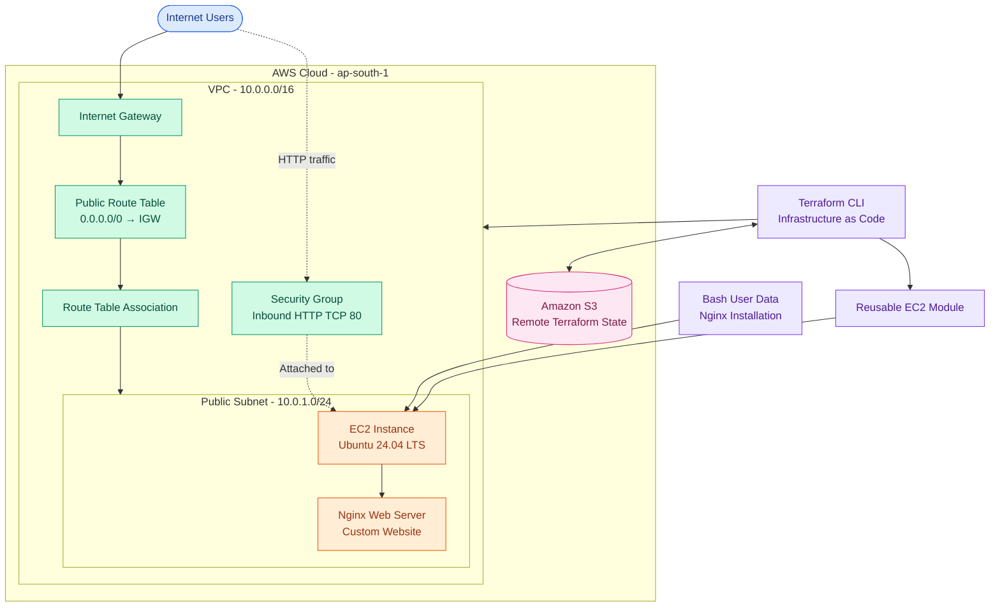

# Terraform AWS Infrastructure Automation & Deployment

**Automating AWS Cloud Infrastructure with Terraform (Infrastructure as Code)**


Build • Provision • Automate • Deploy

---

## 1. Project Overview

This project demonstrates the automated provisioning and deployment of AWS infrastructure using **Terraform**.

It provisions a custom Virtual Private Cloud (VPC), configures public networking, deploys an Ubuntu 24.04 LTS EC2 instance, and automatically installs an Nginx web server using a Bash user-data script.

The project also demonstrates reusable Terraform modules, remote state management with Amazon S3, native state locking, and automated configuration validation using GitHub Actions.

### Project Objectives

- Automate AWS infrastructure provisioning using Terraform.
- Design and configure a custom VPC and public subnet.
- Configure Internet Gateway, route table and subnet association.
- Implement security groups for HTTP access.
- Deploy and configure an Ubuntu EC2 instance.
- Automate Nginx installation and website deployment.
- Implement reusable Terraform modules.
- Configure Amazon S3 remote state and native state locking.
- Integrate GitHub Actions for Terraform validation.

---

## 2. AWS Infrastructure Architecture

The following architecture illustrates the AWS infrastructure and the deployment workflow.

### Architecture Diagram



### Architecture Components

| Component | Purpose |
|---|---|
| Amazon VPC | Provides an isolated virtual network |
| Internet Gateway | Enables internet connectivity |
| Public Subnet | Hosts the EC2 instance |
| Public Route Table | Routes internet-bound traffic through the IGW |
| Route Table Association | Associates the route table with the subnet |
| Security Group | Allows inbound HTTP traffic on TCP port 80 |
| Amazon EC2 | Runs Ubuntu 24.04 LTS |
| Nginx | Hosts and serves the custom website |
| Amazon S3 | Stores Terraform remote state |
| Terraform Module | Provides reusable EC2 configuration |
| Bash User Data | Automates Nginx installation and configuration |

### Deployment Workflow

**Terraform Configuration → AWS Networking → Security Configuration → EC2 Provisioning → Nginx Installation → Website Deployment → Browser Access**

---

## 3. Technology Stack

| Technology | Purpose |
|---|---|
| Amazon Web Services | Cloud infrastructure |
| Terraform | Infrastructure as Code |
| HCL | Terraform configuration language |
| Amazon VPC | Network infrastructure |
| Amazon EC2 | Virtual compute |
| Ubuntu 24.04 LTS | Server operating system |
| Nginx | Web server |
| Amazon S3 | Remote Terraform state |
| Bash | Server initialization |
| Git & GitHub | Version control |
| GitHub Actions | Automated Terraform validation |
| AWS CLI | AWS command-line management |

---

## 4. Project Directory Structure

```text
terraform-aws-infrastructure-automation/
│
├── .github/
│   └── workflows/
│       └── terraform-validation.yml
│
├── modules/
│   └── ec2/
│       ├── main.tf
│       ├── variables.tf
│       └── outputs.tf
│
├── .gitignore
├── .terraform.lock.hcl
├── backend.tf
├── backend.hcl.example
├── .gitattributes
├── main.tf
├── outputs.tf
├── provider.tf
├── terraform.tfvars.example
├── user_data.sh
├── variables.tf
├── versions.tf
└── README.md
```

### File Responsibilities

| File | Responsibility |
|---|---|
| `main.tf` | Defines AWS networking, the SSM IAM role and module configuration |
| `provider.tf` | Configures the AWS provider |
| `variables.tf` | Declares input variables |
| `outputs.tf` | Exposes infrastructure outputs |
| `versions.tf` | Defines Terraform and provider version constraints |
| `backend.tf` | Declares the S3 backend (values are supplied at init time) |
| `backend.hcl.example` | Template for your private, git-ignored `backend.hcl` |
| `user_data.sh` | Installs and configures Nginx |
| `terraform.tfvars.example` | Provides sample variable values |
| `modules/ec2/` | Contains reusable EC2 resources |
| `.terraform.lock.hcl` | Locks provider selections |
| `.gitignore` | Excludes local and sensitive files |
| `.github/workflows/` | Contains GitHub Actions automation |

**Security:** The actual `terraform.tfvars`, state files, plan files and `.terraform/` directory are intentionally excluded from Git.

---

## 5. Prerequisites

Before deploying the project, prepare:

- An AWS account.
- Terraform CLI installed.
- AWS CLI installed and configured.
- Git installed.
- An IAM identity with the required AWS permissions.
- An existing Amazon S3 bucket for remote state.

### S3 Backend Preparation

Before running Terraform initialization:

1. Create an S3 bucket in your chosen AWS region.
2. Enable bucket versioning.
3. Enable server-side encryption.
4. Enable all S3 Block Public Access settings.
5. Ensure your IAM identity has the required state and lock-file permissions.

The backend bucket must exist before Terraform initializes the S3 backend.

---

## 6. Deployment Instructions

### Step 1 — Clone the Repository

```powershell
git clone https://github.com/Gnaneshambati1/terraform-aws-infrastructure-automation.git

cd terraform-aws-infrastructure-automation
```

### Step 2 — Configure AWS Credentials

Configure AWS CLI credentials or another supported AWS authentication method.

Do not store AWS access keys or secret keys in Terraform files or GitHub.

### Step 3 — Configure the S3 Backend

Copy the backend template and fill in your own values:

```powershell
Copy-Item backend.hcl.example backend.hcl
```

Edit `backend.hcl` with your own S3 bucket name, state key and region. This file is excluded from Git, so your bucket name is never published.

Do not initialize the project using another person's S3 bucket.

### Step 4 — Configure Variables

Create your local variable file:

```powershell
Copy-Item terraform.tfvars.example terraform.tfvars
```

Update the values according to your AWS deployment requirements.

### Step 5 — Initialize Terraform

```powershell
terraform init -reconfigure "-backend-config=backend.hcl"
```

In PowerShell, keep the quotes around the `-backend-config` argument. Without them, PowerShell splits the argument at the dot.

### Step 6 — Format and Validate

```powershell
terraform fmt -recursive

terraform validate
```

### Step 7 — Review the Deployment Plan

```powershell
terraform plan
```

Review the proposed infrastructure changes before deployment.

### Step 8 — Deploy AWS Infrastructure

```powershell
terraform apply
```

Review the plan and approve the deployment when prompted.

### Step 9 — Retrieve Outputs

```powershell
terraform output
```

Retrieve the website URL:

```powershell
terraform output -raw web_server_url
```

Open the returned URL in your browser to access the deployed Nginx website.

Allow a few minutes for EC2 initialization and Nginx installation.

---

## 7. Terraform State Management

This project uses an Amazon S3 remote backend to store Terraform state.

### Implemented Features

- Remote state storage using Amazon S3.
- Backend encryption enabled.
- Native S3 state locking using `use_lockfile = true`.
- S3 bucket versioning recommended for state recovery.
- Local state backups maintained separately.
- Terraform state files excluded from GitHub.

### Useful Terraform Commands

```powershell
terraform state list

terraform state show module.web_server.aws_instance.this

terraform state pull
```

**Important:** Terraform state can contain sensitive infrastructure information. Never commit state files or backups to a public repository.

---

## 8. GitHub Actions — Terraform Validation

This repository includes a GitHub Actions workflow:

`.github/workflows/terraform-validation.yml`

### Automated Checks

The workflow performs:

1. Repository checkout.
2. Terraform CLI setup.
3. Terraform formatting verification.
4. Terraform initialization without accessing the remote backend.
5. Terraform configuration validation.

The workflow runs on pushes to the `main` branch and pull requests.

**Note:** This workflow validates Terraform configuration. It does not deploy or destroy AWS infrastructure.

---

## 9. Security Best Practices

Security measures implemented in this project include:

- Dedicated IAM identity for Terraform operations.
- No hardcoded AWS credentials.
- No public SSH ingress rule; the instance is managed through AWS Systems Manager Session Manager using a least-privilege instance role.
- HTTP access limited to TCP port 80 (intentionally open to the internet for this demo; no TLS yet).
- EC2 Instance Metadata Service Version 2 (IMDSv2) required.
- Encrypted EC2 root EBS volume.
- Terraform state stored remotely in Amazon S3.
- State files, local variable files and the backend configuration file (`backend.hcl`) excluded from Git.
- No credentials or secrets stored in any Terraform file.

### Production Recommendations

For production workloads, consider:

- HTTPS using SSL/TLS certificates.
- Restricting public access wherever possible.
- Private subnets for application servers.
- Least-privilege IAM policies.
- Centralized monitoring and logging.
- Secure administrative access through AWS Systems Manager.

---

## 10. Cost Considerations

AWS resources may incur charges depending on region, configuration and usage.

Potential charges include:

- EC2 instance usage.
- EBS storage.
- Public IPv4 address usage.
- Amazon S3 storage and requests.

Review AWS pricing before deployment. Back up Terraform state and inspect the destroy plan before removing infrastructure.

---

## 11. Project Screenshots

Screenshots will be added after final deployment verification.

Recommended screenshots:

1. Terraform successful deployment output.
2. AWS VPC and networking resources.
3. Running EC2 instance.
4. Custom Nginx website in a browser.
5. Terraform output values.
6. Successful GitHub Actions validation.

---

## 12. Skills Demonstrated

- Infrastructure as Code (IaC).
- AWS infrastructure provisioning.
- VPC and public networking.
- EC2 deployment and configuration.
- Terraform variables, outputs and modules.
- Remote state and state locking.
- Linux server configuration.
- Bash scripting.
- Nginx web server deployment.
- Git and GitHub.
- GitHub Actions automation.
- Infrastructure security and troubleshooting.

---

## 13. Future Enhancements

- HTTPS configuration.
- Application Load Balancer.
- Auto Scaling Group.
- Private subnet architecture.
- CloudWatch monitoring and alerts.
- Automated deployment pipeline.
- Multi-environment Terraform configuration.

---

## 14. Troubleshooting

### The web server does not respond after `terraform apply`

**Symptom:** The EC2 instance is running, but `http://<public-ip>` does not connect.

**Root cause:** The `user_data.sh` file began with a blank line before `#!/bin/bash`. cloud-init only runs user data as a script when the shebang is the very first line, so Nginx was never installed. The file also had stray text at the end that caused a shell syntax error.

**Fix:** Make `#!/bin/bash` the first line, remove the stray text, and store the script with LF line endings (enforced by `.gitattributes`).

### Diagnosing a similar problem

Connect without SSH using Session Manager:

```powershell
aws ssm start-session --region ap-south-1 --target <instance-id>
```

Then run:

```bash
cloud-init status --long
sudo tail -50 /var/log/user-data.log
sudo systemctl status nginx --no-pager
curl -I localhost
```

- If `curl localhost` works but the browser does not, check the security group, route table and that the URL uses `http://`.
- If there is no `/var/log/user-data.log`, cloud-init did not run the script. Check the shebang and line endings.

---

## Project Information

| Detail | Value |
|---|---|
| Project | Terraform AWS Infrastructure Automation & Deployment |
| Cloud Platform | Amazon Web Services |
| IaC Tool | Terraform |
| Operating System | Ubuntu 24.04 LTS |
| Web Server | Nginx |
| Deployment Region | Asia Pacific (Mumbai) |
| Repository | [GitHub Project](https://github.com/Gnaneshambati1/terraform-aws-infrastructure-automation) |

---

**Built as a practical Cloud & DevOps portfolio project to demonstrate AWS infrastructure provisioning, automation and deployment using Terraform.**
